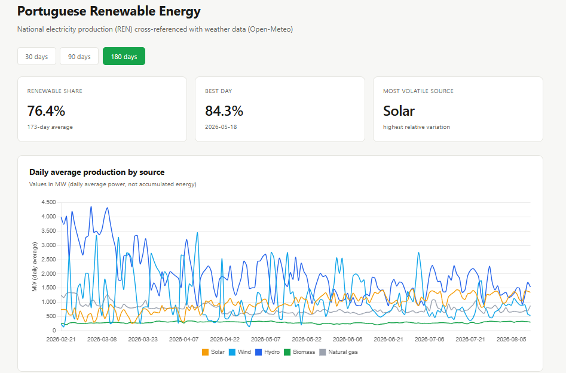
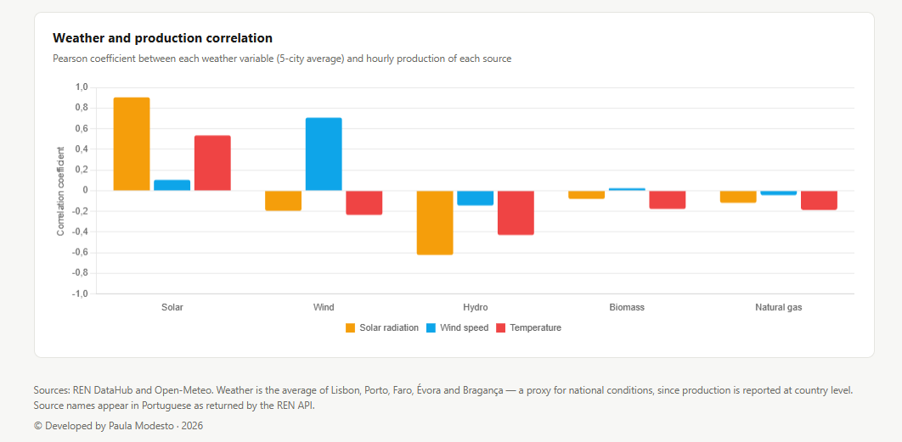

# Portuguese Renewable Energy Analysis

Cross-referencing Portugal's national electricity production (REN) with
weather data (Open-Meteo) to answer a question neither source answers alone:

> **How much does Portuguese renewable production depend on the weather,
> and which source is the most volatile?**

 



*Dashboard showing the last 180 days. Figures in the Findings section
cover the full dataset.*

---

## Table of contents

- [Overview](#overview)
- [Tech stack](#tech-stack)
- [Architecture](#architecture)
- [Getting started](#getting-started)
- [API endpoints](#api-endpoints)
- [Findings](#findings)
- [Validation against published figures](#validation-against-published-figures)
- [Design decisions](#design-decisions)
- [Limitations](#limitations)
- [Project structure](#project-structure)
- [Testing](#testing)

---

## Overview

A Flask application that automatically collects data from two independent
public sources, stores it in PostgreSQL, and exposes an analysis API plus
a dashboard.

- **REN DataHub** — national electricity production by source, at
  15-minute resolution
- **Open-Meteo** — hourly weather archive for five Portuguese cities

Roughly 260,000 production records and 22,000 weather records covering
six months (february to august), aligned by timestamp and timezone.

---

## Tech stack

| Layer | Technology |
|---|---|
| Web framework | Flask (application factory, blueprints) |
| ORM & migrations | SQLAlchemy, Flask-Migrate (Alembic) |
| Database | PostgreSQL 16 (Docker) |
| Analysis | pandas |
| Scheduling | APScheduler |
| Frontend | Chart.js, vanilla JavaScript |
| Testing | pytest |

---

## Architecture

```
External APIs          Ingestion            Storage         Analysis        Presentation
─────────────          ─────────            ───────         ────────        ────────────
REN DataHub    ──┐
                 ├──►  app/clients/  ──►  PostgreSQL  ──►  app/services/  ──►  REST API
Open-Meteo     ──┘     app/services/       (Docker)         (pandas)           Chart.js
                       ingestion.py
                            ▲
                            │
                    APScheduler (daily)
```

Separation of concerns:

- **`clients/`** talks to external APIs. This is where things fail —
  timeouts, downtime, malformed responses.
- **`services/ingestion.py`** writes to the database. Shared by the
  backfill scripts and the scheduled job, so there is one implementation,
  not two that can drift apart.
- **`services/analytics.py`** computes over stored data. Never touches
  the network.
- **`routes/`** exposes HTTP endpoints. Validates parameters, returns JSON.

---

## Getting started

### Prerequisites

- Python 3.14
- Docker Desktop

### 1. Clone and set up the environment

```bash
git clone https://github.com/paulanm01/renewables-pt.git
cd renewables-pt

python -m venv .venv
.venv\Scripts\Activate.ps1     # Windows PowerShell
# source .venv/bin/activate    # macOS / Linux

pip install -r requirements.txt
```

### 2. Environment variables

### 2. Environment variables

Copy the example file and fill in your own values:

```bash
cp .env.example .env
```

The `.env` file holds the database credentials and is not versioned.

### 3. Start PostgreSQL

```bash
docker compose up -d
```

The container maps host port **5434** to the container's 5432, avoiding
conflicts with a locally installed PostgreSQL.

### 4. Create the schema

```bash
flask db upgrade
```

### 5. Load historical data

```bash
python -m scripts.backfill_ren
python -m scripts.backfill_weather
```

> Scripts must be run with `python -m` so the project root is on the
> import path. Running the file directly (`python scripts/backfill_ren.py`)
> puts the script's folder on the path instead, and package imports fail.

The REN backfill takes 5–7 minutes (one request per day). The weather
backfill takes seconds — the archive API returns whole date ranges in a
single request, so five cities cost five requests in total.

Both backfills are idempotent: running them twice produces the same
result, not duplicates.

### 6. Run

```bash
python run.py
```

Dashboard at `http://127.0.0.1:5000`

---

## API endpoints

### `GET /api/production/timeline`

Daily average production, optionally filtered by source.

| Parameter | Type | Description |
|---|---|---|
| `start` | `YYYY-MM-DD` | Optional. Start of range. |
| `end` | `YYYY-MM-DD` | Optional. End of range. |
| `source` | string | Optional. For example: `Solar`, `Eólica`. |

```json
[
  { "day": "2026-08-07", "source": "Solar", "avg_mw": 1304.3 }
]
```

### `GET /api/correlation/weather-production`

Pearson correlation between weather variables and production.

| Parameter | Type | Description |
|---|---|---|
| `source` | string | Defaults to `Solar`. |
| `start`, `end` | `YYYY-MM-DD` | Optional. |

```json
{
  "source": "Solar",
  "hours_compared": 4344,
  "correlations": {
    "shortwave_radiation": 0.904,
    "temperature_c": 0.545,
    "wind_speed_kmh": 0.028
  }
}
```

### `GET /api/insights`

Records and volatility for the period.

```json
{
  "period_days": 186,
  "avg_renewable_pct": 76.1,
  "best_day": { "day": "2026-05-18", "renewable_pct": 84.3 },
  "worst_day": { "day": "2026-02-08", "renewable_pct": 63.9 },
  "most_volatile_source": "Solar"
}
```

Invalid date parameters return `400`, not `500`.

---

## Findings


All figures below cover **8 February – 12 August 2026** (186 days).
Figures as of 12 August 2026; the dataset updates daily, so current
values may differ slightly.

### Solar tracks radiation almost perfectly (+0.90)

Photovoltaic output correlates at **+0.90** with shortwave radiation —
close to a linear relationship. As a source that depends directly on
daylight, it is also the most volatile in relative terms, driven by the
day/night cycle and passing cloud cover.

### Wind correlates strongly, but less so (+0.77)

Wind speed correlates at **+0.77** with wind generation. The relationship
is weaker than solar for three reasons:

- The archive reports wind at **10 m above ground**, while turbines
  operate at 80–120 m, where wind is stronger and steadier.
- Turbines cut out above a certain speed for safety, so the relationship
  is not linear across the full range.
- Wind farms sit at varying altitudes and regions, not at the five cities
  used as the weather proxy.

### Hydro is negatively correlated — and it is not causal (−0.62)

Hydro production correlates at **−0.62** with solar radiation and **−0.44**
with temperature. This is not a causal relationship — sunshine does not
prevent dams from generating.

The most likely explanation is a combination of seasonality and the fact 
that hydro can be turned on and off as needed. Winter and spring bring 
higher water inflow and lower radiation; summer brings the opposite. 
Unlike wind and solar, hydro output reflects reservoir management decisions 
rather than instantaneous weather, so operators can hold water back and release 
it when it is most needed.

This is a useful reminder that a strong correlation shows that two things move together.
It does not show that one causes the other.

### Renewable share: 76.1% average, 84.3% peak

Across the period, renewables averaged **76.1%** of total production. The
best single day reached **84.3%** (18 May 2026); even the worst day still
covered **63.9%** (8 February 2026).

### Highest share is not the same as highest output

The day with the highest renewable share (18 May, 84.3%) produced **less**
renewable power in absolute terms than 4 March (979 MW vs 1,211 MW).

The share is a fraction: renewable output divided by total output. It can
go up either because renewables produced more, or because everything else
produced less. Here it was the second.

| | 4 March | 18 May |
|---|---|---|
| Renewable | 1,211 MW | 979 MW |
| Non-renewable | 361 MW | 182 MW |
| **Total** | **1,572 MW** | **1,161 MW** |
| **Renewable share** | **77.0%** | **84.3%** |

Total output in May was roughly **26% lower**. Mild spring temperatures
reduce demand, and when demand falls the more expensive natural gas plants
are the first to come offline — leaving a larger proportion of the load to
renewables. March, despite higher hydro and wind peaks, needed twice as
much gas generation, which diluted the final share.

**The May record came from the combination of clean production and low
demand, not from clean production alone.** The timeline chart shows
absolute output in MW while the KPI shows share as a percentage; the two
can point in different directions.

---

## Validation against published figures

To check the integrity of the pipeline, results were compared against
figures published by APREN (Associação Portuguesa de Energias Renováveis)
in August 2026.

**Headline figure.** The pipeline computes an average renewable share of
**76.1%** (February–August 2026), against the **75.0%** APREN reports for
January–July 2026 — a difference of 1.1 percentage points.

Two methodological differences account for most of that gap:

| | This pipeline | APREN |
|---|---|---|
| Window | Feb–Aug 2026 | Jan–Jul 2026 |
| Aggregation | Average power (MW) | Accumulated energy (GWh) |

**Seasonal pattern.** APREN reported solar leading the electricity mix for
the first time in July 2026, at 25.8% of generation. The pipeline shows the
same trend independently: average daily solar output rises steadily from
roughly 270 MW in February to roughly 1,300 MW in August.

---

## Design decisions

### 1. Long format instead of one column per source

The table stores one row per (timestamp, source) rather than columns named
`solar`, `wind`, `hydro`. If REN adds a new source it becomes extra rows,
not a schema change and migration. It also makes pandas `groupby`
operations natural.

### 2. Store at 15-minute resolution, aggregate at analysis time

REN publishes every 15 minutes. Storing at that resolution produces around
260,000 rows; aggregating on ingest would have been lighter. But once data is 
thrown away it cannot be recovered, so the hourly resampling happens later, 
only when it is needed.

### 3. MW, not MWh

The values are instantaneous power. Summing 96 power readings does not
produce energy. Daily averages in MW are honest and easy to explain; a
conversion to MWh would add a step where a wrong factor could silently
corrupt every figure.

### 4. Idempotent ingestion

Running a backfill twice produces the same result. 
Two things make sure of this: the code deletes the target day before
writing it again, and the database has a unique constraint on
(timestamp, source). The constraint is the real guarantee — code can
be run in unexpected ways, but nothing gets past the database.

### 5. The scheduler ingests day D-7, not yesterday

The ERA5 archive lags 5–7 days. Aligning collection with the slower source
means one code path and both sources always arriving complete, rather than
special handling for missing weather data.

### 6. Store km/h, the unit the source provides

Open-Meteo returns wind speed in km/h. The column is named
`wind_speed_kmh` and the value is stored as received rather than converted
to m/s on ingest. Converting later is always possible; un-converting a
wrong factor is not.

### 7. `clients/` separate from `services/`

Clients fetch external data — that is where failures happen (network,
timeouts, API downtime). Services compute over stored data. Keeping them
apart means the analysis logic can be tested without internet access.

### 8. One parameterised endpoint instead of two near-identical ones

The initial plan had separate `/timeline` and `/by-source` endpoints. They
turned out to be the same query with a different filter, so they were
merged into one with a `source` parameter.

### 9. No cloud deployment

APScheduler runs inside the Flask process. On free hosting tiers the
application sleeps after inactivity and the scheduler sleeps with it —
producing a project that promises automated collection and collects
nothing. Running locally and documenting it properly is more honest.

### 10. Parsing separated from the HTTP call

`fetch_production()` makes the request; `parse_production()` transforms the
payload. This allows the transformation to be tested with a hand-written
JSON fixture, without network access.

### 11. Translation only at the presentation layer

Source names travel through the data layer in Portuguese, exactly as the
REN API returns them, and are translated to English only in the frontend
via a label map. Translating them in the data would break correspondence
with the API.

---

## Limitations

### The five-city weather proxy

REN production figures are national. Weather comes from five points
(Lisbon, Porto, Faro, Évora, Bragança). Their average approximates
conditions across Portugal — it does not measure them. Fog over the
Alentejo, where the large solar plants are, would not register if the five
cities were clear.

### Wind is measured at 10 m; turbines operate at 80–120 m

The archive reports wind speed near ground level. Turbines work far higher,
in stronger and steadier wind, and cut out above a threshold. This likely
explains why wind correlates at 0.77 while solar reaches 0.90.

### MW is not energy

All figures are instantaneous power. Daily averages answer "what was the
average power output", not "how much energy was produced". Converting to
MWh would require multiplying by the hours in the period.

### Seven-day data lag

ERA5 publishes 5–7 days after the fact, so the dashboard never shows the
most recent week. This is why the "180 days" button reports an average over
roughly 172 days.

### Hydro is dispatchable, wind and solar are not

The −0.62 correlation between radiation and hydro output is not causal.
Wind and solar produce whatever the weather allows at that moment. Hydro
is different: the water is stored, and operators choose when to release
it. Output follows those decisions and the seasons, not the weather in
that hour.

### Six-month sample

The dataset does not cover a full year, so it does not capture the complete
seasonal cycle. Winter peaks and the driest part of summer are only partly covered.

---

## Project structure

```
renewables-pt/
├── app/
│   ├── __init__.py           # application factory
│   ├── config.py
│   ├── constants.py          # REN series classification
│   ├── extensions.py
│   ├── scheduler.py
│   ├── clients/              # external API access
│   │   ├── ren_client.py
│   │   └── open_meteo_client.py
│   ├── models/
│   │   ├── production.py
│   │   └── weather.py
│   ├── services/
│   │   ├── ingestion.py      # shared write logic
│   │   └── analytics.py      # pandas analysis
│   ├── routes/
│   │   ├── api.py
│   │   └── views.py
│   ├── templates/
│   └── static/js/
├── scripts/
│   ├── backfill_ren.py
│   └── backfill_weather.py
├── tests/
│   └── test_analytics.py
├── docker-compose.yml
└── requirements.txt
```

---

## Testing

```bash
python -m pytest tests/ -v
```

Four unit tests cover the REN response parser and the series
classification. They run in about a second, without network or database
access, because the parsing logic is separated from the HTTP call —
`parse_production()` receives an already-loaded payload.

The analytics functions are not tested. They read from the database, so
testing them would mean setting up a test database with sample data.
That was a deliberate choice about scope, not something I forgot.

---

## A note on the REN API format

The REN endpoint returns data shaped for a JavaScript charting library
rather than for data consumption. Timestamps live in
`xAxis.categories` as a separate array from the values in `series[].data`,
linked only by array position:

```json
{
  "xAxis": { "categories": ["00:00", "00:15", "00:30"] },
  "series": [
    { "name": "Solar", "data": [0.4, 0.0, 0.0] }
  ]
}
```

The parser zips the two arrays back together and attaches the requested
date, since the API supplies only the time of day.

A second detail matters for correctness: the endpoint is called
*production breakdown*, but 5 of its 15 series are not production —
`Consumo`, `Consumo + Armazenamento`, `Importação`, `Exportação` and
`Bombagem` describe electricity demand, imports and exports with Spain, and water
pumped uphill for storage. Every series is classified before anything is
added up, so consumption is never counted as production.

---

## Data sources

- [REN DataHub](https://datahub.ren.pt) — Portuguese electricity system operator
- [Open-Meteo](https://open-meteo.com) — historical weather archive (ERA5)

Source names appear in Portuguese throughout the data layer, as returned
by the REN API.

---

© 2026 Paula Modesto